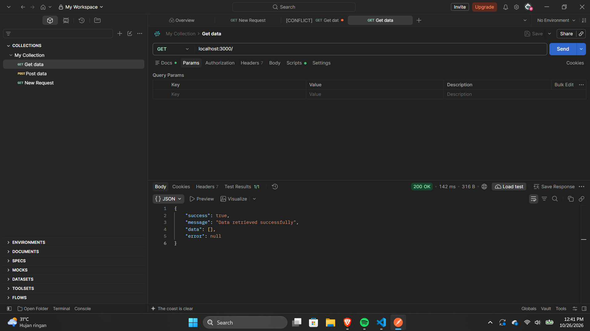
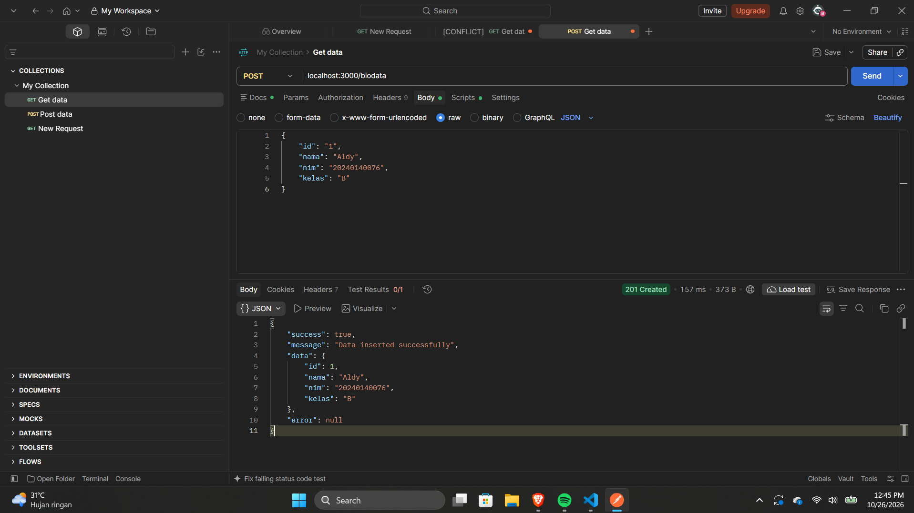
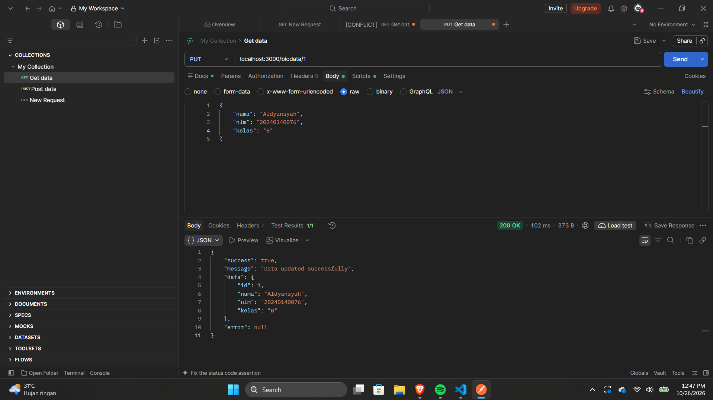
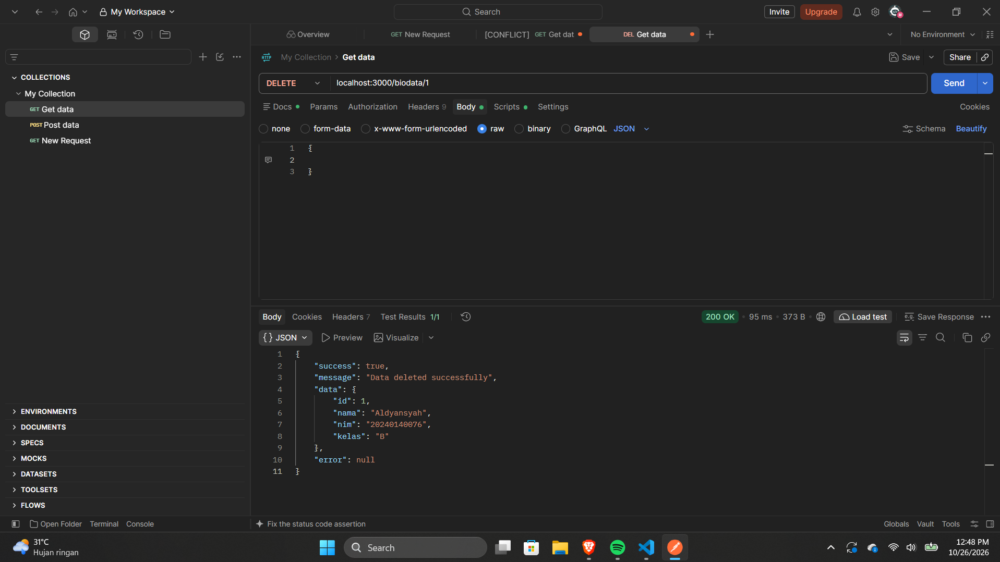

# Web Service Biodata

REST API sederhana untuk mengelola data biodata mahasiswa menggunakan Express.js dan PostgreSQL.

## Teknologi

- Node.js
- Express.js
- PostgreSQL
- Joi untuk validasi request

## Persiapan

Pastikan Node.js dan PostgreSQL sudah terpasang. Buat database dan tabel berikut:

```sql
CREATE DATABASE mahasiswa;
```

Lalu, hubungkan ke database `mahasiswa` dan buat tabel:

```sql
CREATE TABLE biodata (
    id INTEGER GENERATED BY DEFAULT AS IDENTITY PRIMARY KEY,
    nama VARCHAR(100) NOT NULL,
    nim VARCHAR(20) NOT NULL,
    kelas VARCHAR(20) NOT NULL
);
```

Konfigurasi database pada aplikasi menggunakan host `localhost`, port `5432`, database `mahasiswa`, user `postgres`, dan password `postgres`. Sesuaikan konfigurasi di `index.js` jika kredensial PostgreSQL lokal Anda berbeda.

## Menjalankan aplikasi

```bash
npm install
npm start
```

Server berjalan di `http://localhost:3000`.

## Endpoint API

| Method | Endpoint | Deskripsi |
| --- | --- | --- |
| `GET` | `/` | Mengambil semua data biodata |
| `POST` | `/biodata` | Menambahkan data biodata |
| `PUT` | `/biodata/:id` | Mengubah biodata berdasarkan ID |
| `DELETE` | `/biodata/:id` | Menghapus biodata berdasarkan ID |

### Contoh request

`POST /biodata` menerima JSON berikut. Field `id` bersifat opsional dan dapat dibuat otomatis oleh database.

```json
{
  "nama": "Aldy",
  "nim": "20240140076",
  "kelas": "B"
}
```

`PUT /biodata/:id` memerlukan semua field berikut; `id` disediakan melalui parameter URL, bukan body.

```json
{
  "nama": "Aldyansyah",
  "nim": "20240140076",
  "kelas": "B"
}
```

Field `nama` harus berisi 2–100 karakter, `nim` 5–20 karakter, dan `kelas` 1–20 karakter. Nilai teks akan di-trim. Parameter `id` harus berupa bilangan bulat positif.

### Format respons

Respons sukses menggunakan format berikut:

```json
{
  "success": true,
  "message": "Data retrieved successfully",
  "data": [],
  "error": null
}
```

Jika validasi gagal, API mengembalikan status `400`. Data yang tidak ditemukan pada operasi ubah atau hapus mengembalikan status `404`.

## Dokumentasi gambar

Gambar berikut menunjukkan pengujian endpoint menggunakan Postman.

### GET — mengambil data



### POST — menambahkan data



### PUT — mengubah data



### DELETE — menghapus data


